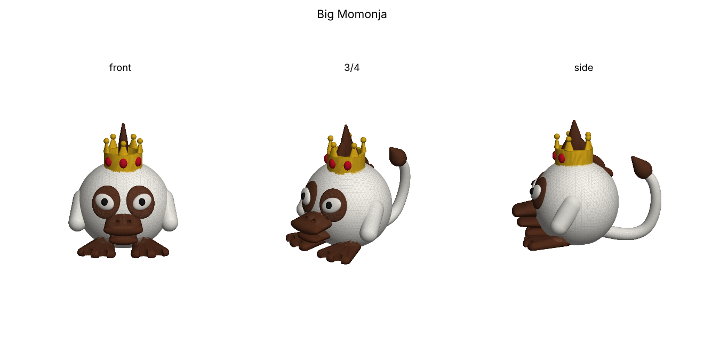

# ビッグももんじゃ

ドラゴンクエストモンスターズ キャラバンハートに登場する「ビッグももんじゃ」のファンメイド3Dモデルです。
本体データはリポジトリ直下の `ビッグももんじゃ.3mf`。



## 参考にした特徴
- 白い体毛の丸々と太った一頭身の体
- キングスライムを意識した王冠
- チョコレート色のクチバシ・モヒカン・しっぽの先
- タヌキのような目のまわりの隈、釣り目の白目に「・」の黒目
- アヒルのような水かきのある足、サルのような長いしっぽ

## 印刷
- サイズ: 約 61 × 84 × 69 mm（スライサーで拡大縮小可）
- 1つのオブジェクトに色別パーツ5つ（白 / チョコ色 / 黒 / 金 / 赤）。スライサーで各パーツにフィラメントを割り当ててください。4色しか使えない場合は宝石（赤）を黒かチョコ色にすると4色で印刷できます
- 腕・クチバシ・体の下側・しっぽの先がオーバーハングになるため、サポートをつけるのがおすすめです

## 再生成
```bash
pip install manifold3d numpy matplotlib
python3 big_momonja.py
```
寸法や形は `big_momonja.py` の数値を変えて調整できます。
