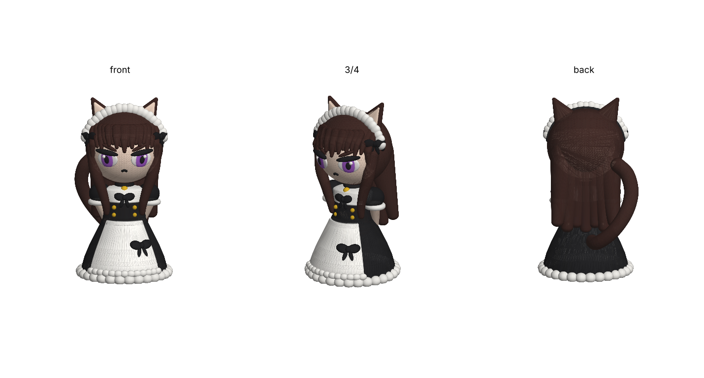

# ネコ耳メイド（ちびキャラフィギュア）

いただいたイラストのキャラクターを、3Dプリントしやすい2頭身のちびキャラにしたモデルです。
本体データはリポジトリ直下の `ネコ耳メイド.3mf`。



## イラストから再現した要素
- 濃い茶色のストレートロング、ぱっつん前髪、サイドの毛束
- 茶色のネコ耳（内側ピンク）と、ネコのしっぽ
- 黒いカチューシャに白いフリルのヘッドドレス、黒いリボン
- 紫の瞳、ジト目、への字口
- 金の鈴がついた黒いチョーカー
- パフスリーブの黒いワンピースとコルセット（金ボタン）、白いブラウス、フリルつきの白エプロン

## 印刷
- サイズ: 約 54 × 59 × 96 mm（スライサーで拡大縮小可）
- 1つのオブジェクトに色別パーツ6つ: 肌 / 髪（茶） / 黒 / 白 / 紫 / 金。スライサーで各パーツにフィラメントを割り当ててください
  - 4色しか使えない場合: 金→白や黒、紫→黒、に割り当てると「肌・茶・黒・白」の4色で印刷できます
- あご下、腕、しっぽ、サイドの毛束、耳がオーバーハングになるのでサポートをつけてください。ツリーサポートがおすすめです
- 顔のパーツは小さいので、0.4mmノズルなら等倍以上がおすすめです

## 再生成
```bash
pip install manifold3d numpy matplotlib
python3 catmaid.py
```
